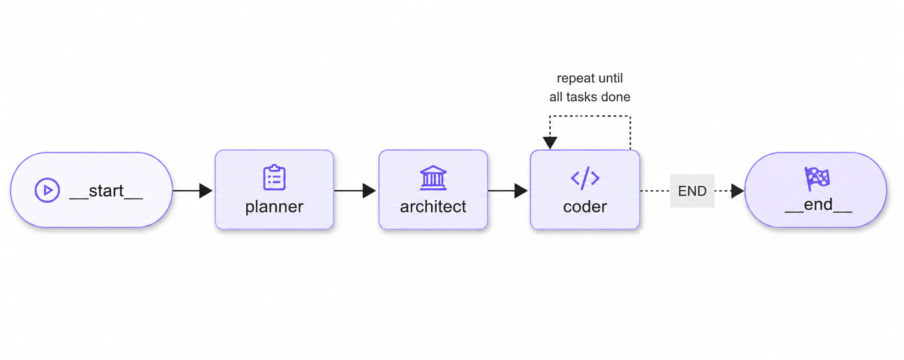

# 🛠️ Chef

**CHEF** is an AI-powered coding assistant built with [LangGraph](https://github.com/langchain-ai/langgraph).  
It works like a multi-agent development team that can take a natural language request and transform it into a complete, working project — file by file — using real developer workflows.

---

## 🏗️ Architecture

- **Planner Agent** – Analyzes your request and generates a detailed project plan.
- **Architect Agent** – Breaks down the plan into specific engineering tasks with explicit context for each file.
- **Coder Agent** – Implements each task, writes directly into files, and uses available tools like a real developer.

<div style="text-align: center;">
    
</div>

---

## 🚀 Getting Started

Follow the steps below to run CHEF locally on Windows. The commands should be
run from the repository root:

```text
C:\Users\<your-user>\Desktop\projects\Chef
```

### Prerequisites

Install the following software before setting up the project:

- **Python 3.11 or newer**
- **uv**, the Python package and environment manager. See the
  [uv installation guide](https://docs.astral.sh/uv/getting-started/installation/).
- **Node.js and npm**, required by the React frontend
- A **Groq account and API key**. Create a key at
  [console.groq.com/keys](https://console.groq.com/keys).

You can check that the tools are installed by running:

```powershell
python --version
uv --version
node --version
npm --version
```

### 1. Open the project directory

Open PowerShell and change to the CHEF repository root:

```powershell
cd C:\Users\<your-user>\Desktop\projects\Chef
```

The root directory contains `pyproject.toml`, `server.py`, and the `frontend`
directory.

### 2. Configure the Groq API key

Create a file named `.env` in the project root, next to `pyproject.toml`:

```env
GROQ_API_KEY=your_groq_api_key
```

Do not commit `.env` or share your API key. If a key is accidentally exposed,
revoke it in the Groq console and create a replacement.

### 3. Set up the Python backend

From the project root, create the virtual environment:

```powershell
uv venv
```

Install the backend dependencies:

```powershell
uv pip install --python .venv\Scripts\python.exe -e .
```

The backend is a FastAPI application served by Uvicorn. It exposes the
WebSocket endpoint used by the frontend at `/ws`.

### 4. Set up the React frontend

Open a second PowerShell terminal and move to the frontend directory:

```powershell
cd C:\Users\<your-user>\Desktop\projects\Chef\frontend
```

Install the frontend dependencies:

```powershell
npm install
```

### 5. Start the backend

In the first terminal, from the project root, run:

```powershell
cd C:\Users\<your-user>\Desktop\projects\Chef
.\.venv\Scripts\python.exe -m uvicorn server:app --host 0.0.0.0 --port 8000 --reload
```

Keep this terminal open. The backend is available at
<http://localhost:8000>.

You can verify it is running by opening <http://localhost:8000> or by running:

```powershell
Invoke-WebRequest http://localhost:8000/
```

### 6. Start the frontend

In the second terminal, from the `frontend` directory, run:

```powershell
npm run dev
```

Keep this terminal open as well. Open the URL printed by Vite, normally
<http://localhost:5173>.

Both the backend and frontend must remain running while using the application.
Enter a prompt in the frontend to ask CHEF to generate a project.

### Stopping the application

Press `Ctrl+C` in each terminal to stop the backend and frontend processes.

### Troubleshooting

- **WebSocket connection failed:** Confirm that the backend terminal is
  running and that port `8000` is available.
- **`GROQ_API_KEY` errors:** Confirm that `.env` is in the repository root and
  that the variable name is exactly `GROQ_API_KEY`.
- **`npm` is not recognized:** Install Node.js, reopen PowerShell, and run
  `npm install` again from `frontend`.
- **Port already in use:** Stop the process using port `8000` or `5173`, then
  restart the corresponding server.
- **Missing Python packages:** Run the backend dependency installation command
  again from the repository root.

### 🧪 Example Prompts
- Create a to-do list application using html, css, and javascript.
- Create a simple calculator web application.
- Create a simple blog API in FastAPI with a SQLite database.

---
